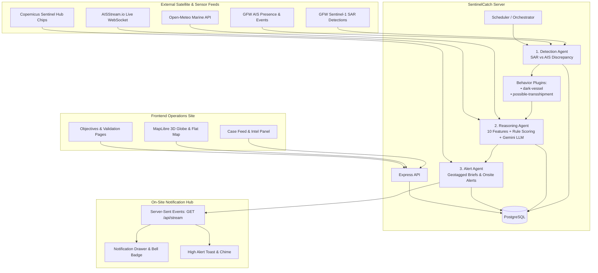

# SentinelCatch 🛡️

**An AI-powered live watch for illegal fishing in Kenya’s waters.**

SentinelCatch is a live website that helps fisheries officers spot “dark vessels”: ships that are physically in Kenya’s Exclusive Economic Zone (EEZ) but have switched off their AIS transponder to avoid being tracked. It compares what satellite radar actually sees on the water against what ships say they’re doing, flags the gap, and alerts officers with a plain-language explanation of why a vessel looks suspicious.

---

## The Problem It Solves

Kenya’s coastline is too large to patrol physically, and vessels that fish illegally can simply go dark. Today there’s no automated way to tell who’s really out there from who says they’re out there. SentinelCatch turns free, open satellite data into something officers can act on.

---

## How It Works

Three cooperating AI agents run continuously:

1. **Detection Agent**: Pulls radar vessel detections (Sentinel-1 SAR) and AIS vessel presence from Global Fishing Watch for Kenya’s EEZ, then isolates vessels the radar sees that AIS doesn’t.
2. **Reasoning Agent**: Studies each candidate: how long it’s been loitering, how close it is to the EEZ boundary, its movement pattern, nearby AIS gaps, fleet proximity, and whether AIS coverage is reliable there. It scores the vessel (0–100) and writes a short explanation in plain language using an LLM.
3. **Alert Agent**: Turns the strongest cases into a geotagged brief (location, time, confidence score, reasoning) and notifies officers live on the site via real-time Server-Sent Events.

---

## Key Features

- **Live map-first operations dashboard** with a flat map and a 3D globe (MapLibre GL JS), and toggleable layers for the Kenya EEZ, Marine Protected Areas (MPAs), raw SAR detections, live AIS ships, AIS coverage confidence, and sea state.
- **On-site notifications**: Bell icon with unread badge, alert drawer, toast banner, pulsing map marker, audio chime toggle, and background tab indicator `(n) SentinelCatch`.
- **Case workflow**: Officers can Acknowledge, Dispatch, or mark a False alarm with an audit trail.
- **Explainable scoring**: Every case shows why it was flagged, 10 computed operational features, and raw satellite evidence.
- **Sector-based routing**: Officers follow specific coastal sectors (Lamu, Malindi-Kilifi, Mombasa, South Coast/Vanga).
- **One-tap sharing**: Export tactical case briefs directly to WhatsApp (`wa.me`) or clipboard.
- **Bilingual**: English and Kiswahili interface.
- **Validation and Objectives scorecards**: Public pages (`/validation` and `/objectives`) backed by live API metrics.
- **Honest limits**: Visible on `/about`, on case cards, and documented below.

---

## System Architecture



---

## Where to Get Each Key

| Variable | Required / Optional | Source | Cost |
|---|---|---|---|
| `DATABASE_URL` | **Required** | [Render Postgres](https://render.com), [Neon](https://neon.tech), or [Supabase](https://supabase.com) | Free tier |
| `GFW_API_TOKEN` | **Required** | [Global Fishing Watch](https://globalfishingwatch.org/our-apis) — register for non-commercial API access | Free |
| `GEMINI_API_KEY` | **Required** | [Google AI Studio](https://aistudio.google.com/apikey) — generate API key | Free tier |
| `AISSTREAM_API_KEY` | Recommended | [AISStream.io](https://aisstream.io) — free account for live ship tracking | Free |
| `COPERNICUS_CLIENT_*` | Optional | [Copernicus Data Space](https://dataspace.copernicus.eu) — OAuth client for optical/radar imagery | Free |
| `MAPTILER_KEY` | Optional | [MapTiler](https://maptiler.com) — only if using custom MapTiler vector styles | Free tier |
| `Open-Meteo` | Built-in | Automatic — no key required for marine wave height & wind speed | Free |

---

## Project Structure

```
SentinelCatch/
├── server/
│   └── src/
│       ├── index.js          # HTTP server & graceful shutdown
│       ├── app.js            # Express application & CSP
│       ├── config.js         # Zod environment validation
│       ├── logger.js         # Pino structured logging
│       ├── db/               # PostgreSQL pool & migrations
│       ├── alerts/           # On-site notification channel & SSE broker
│       ├── integrations/     # GFW, AISStream, Open-Meteo, Gemini, Copernicus
│       ├── agents/           # Detection, Reasoning, Alert agents
│       ├── behaviors/        # Behavior plugins (dark-vessel, possible-transshipment)
│       ├── routes/           # REST endpoints (/api/cases, /api/objectives, etc.)
│       ├── validation/       # Historical negative controls & validation runner
│       └── tests/            # Automated test suite
├── web/                      # React 19 + Vite + MapLibre GL JS
├── docs/                     # BUILD_SPEC, AUDIT, INTEGRATION_NOTES, COMPLIANCE
├── render.yaml               # Render single web service blueprint
├── .env.example              # Clean configuration template
└── README.md
```

---

## Behavior Plugin Architecture

SentinelCatch features an extensible behavior-plugin interface in `server/src/behaviors/`:

1. **`dark-vessel`** (core): Isolates satellite radar detections lacking matching AIS signals.
2. **`possible-transshipment`**: Identifies dark detections loitering or stationary within 2 km of an active AIS vessel.

### Adding a Behavior

Create a file in `server/src/behaviors/<name>.js` implementing:

```javascript
export default {
  id: 'my-behavior',
  name: 'Behavior Name',
  description: 'Operational purpose...',
  detectCandidates: async (detections, context) => {
    // Filter candidates matching spatial-temporal pattern
    return candidates;
  },
  features: async (candidate, context) => {
    // Compute operational features object
    return { ... };
  },
  weights: {
    // Feature weights for transparent rule scoring (0-100)
  },
};
```

---

## Limitations

⚠️ **Critical Operational Limitations:**

- **Detection and alerting only**: SentinelCatch is an early-warning decision-support tool, not an automated interception system.
- **Radar resolution**: Sentinel-1 SAR primarily detects industrial-scale vessels (>25–30 meters); small near-shore wooden artisanal skiffs may not reflect sufficient radar backscatter.
- **Decision support, not legal evidence**: Scores and rationales are probabilistic indicators for prioritizing patrols, not admissible court evidence.
- **AIS coverage limitations**: A missing AIS signal in low-coverage cells may reflect terrestrial receiver gaps or atmospheric fading rather than intentional evasion. The system explicitly factors AIS coverage confidence into every score.
- **Satellite revisit latency**: Sentinel-1 radar passes occur at intervals of 1 to several days over equatorial coastal zones.

---

## Data Source Attributions

- **Global Fishing Watch** — Vessel monitoring data & Sentinel-1 SAR detections ([globalfishingwatch.org](https://globalfishingwatch.org))
- **ESA Copernicus** — Sentinel-1 radar and Sentinel-2 optical imagery ([dataspace.copernicus.eu](https://dataspace.copernicus.eu))
- **AISStream.io** — Real-time AIS vessel telemetry ([aisstream.io](https://aisstream.io))
- **Open-Meteo** — Marine weather and ocean state forecasts ([open-meteo.com](https://open-meteo.com))
- **CARTO / OpenStreetMap** — Basemap tiles & cartographic boundaries (© CARTO, © OpenStreetMap contributors)
