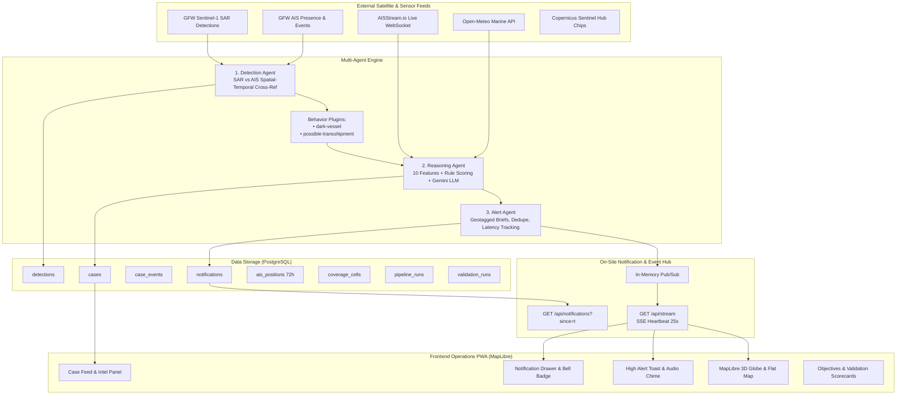

# SentinelCatch Implementation Plan (v3)

**Project**: SentinelCatch — AI-Powered Live Watch for Illegal Fishing in Kenya’s Waters  
**Target Environment**: Node.js 20 ESM, PostgreSQL, Express, React + Vite + MapLibre GL JS, Render Starter Web Service  
**Version**: 3.0.0 (On-site notifications, MapLibre 3D Globe/Flat, Live Objectives Verification)

---

## 1. System Architecture Overview

---

## 2. Core Concepts & Boundaries

### 2.1 Geographic Boundary (Kenya EEZ & Sectors)
- **Bounding Box**: Lat `-4.75` to `0.5`, Lon `39.0` to `45.5`.
- **EEZ Polygon**: Real polygon loaded from official Maritime Boundaries (VLIZ EEZ v11 / GFW region geometry).
- **Four Coastal Sectors**:
  1. *Lamu*: North Kenya border to Ras Tenwi (~2°S).
  2. *Malindi-Kilifi*: Ras Tenwi to Takaungu (~3.7°S).
  3. *Mombasa*: Kilifi Creek to Likoni (~4.1°S).
  4. *South Coast / Vanga*: Likoni to Tanzania border (~4.7°S).

### 2.2 Strict Operational Rules
1. **Never invent API endpoints or fields**: Real calls to GFW, Open-Meteo, AISStream, Gemini; document in `docs/INTEGRATION_NOTES.md`.
2. **Zero mock or demo data in running app**: Real API data only. Stale-data banner (`"SAR data current to <time>; AIS live <sec> ago"`) when sources lag.
3. **Deterministic fallback**: If LLM fails or is unconfigured, rule-based template generates clear, fact-checked rationale citing computed features.
4. **On-site notifications only**: No external push services or email/SMS gateways. All alerts delivered via real-time SSE with local client caching.

---

## 3. Detailed Stages & Checkpoints

### Stage B: Channel Cleanup, Schema Migration & Clean Build
- [ ] **B.1**: Remove obsolete dependencies (`web-push`, `nodemailer`) from `server/package.json`.
- [ ] **B.2**: Purge unused environment variables (`VAPID_*`, `TELEGRAM_*`, `SMTP_*`, `EMAIL_*`, `AT_*`, `ALERT_SMS_NUMBERS`) from `.env.example`, `.env`, `render.yaml`, and `server/src/config.js`.
- [ ] **B.3**: Create migration `server/src/db/migrations/002_onsite_notifications.sql`:
  - Drop table `push_subscriptions`.
  - Drop table `alert_log`.
  - Create table `notifications` (`id`, `case_id`, `type`, `band`, `headline`, `body`, `lat`, `lon`, `sector`, `score`, `created_at`, `broadcast_latency_ms`).
- [ ] **B.4**: Build channel-adapter interface in `server/src/alerts/index.js` with only the `onsite` adapter.
- [ ] **B.5**: Clean `/api/status` endpoint so only active integrations appear (GFW, AISStream, Gemini LLM, Open-Meteo, Copernicus).
- [ ] **B.6**: Verify server starts cleanly with minimal Part E configuration.
- 👉 **CHECKPOINT B**: App builds and runs with only Part E keys.

---

### Stage C: On-Site Notification Engine & Live Stream
- [ ] **C.1**: In-memory pub/sub broker (`server/src/alerts/broker.js`) for broadcasting events: `notification`, `case_update`, `status`, `ais_tick`.
- [ ] **C.2**: Server-Sent Events endpoint `GET /api/stream`:
  - 25-second keepalive comment (`: keepalive\n\n`) to prevent Render proxy timeouts.
  - `Last-Event-ID` tracking for reconnect replay from `notifications` table.
- [ ] **C.3**: Polling fallback endpoint `GET /api/notifications?since=<timestamp>&limit=50`.
- [ ] **C.4**: System test notification endpoint `POST /api/notifications/test`:
  - Inserts type `system_test`, band `High`, headline `"System Test Alert"`.
  - Measures end-to-end `broadcast_latency_ms`.
- [ ] **C.5**: Update Alert Agent (`server/src/agents/alert.js`) to write to `notifications` and publish through broker.
- 👉 **CHECKPOINT C**: Trigger system test notification via curl/API and verify SSE delivery and database storage.

---

### Stage D: Multi-Agent Engine & Integrations
- [ ] **D.1**: `server/src/integrations/gfw.js`:
  - Authenticate with `GFW_API_TOKEN`.
  - Query Sentinel-1 SAR presence (`public-global-sar-presence:latest`).
  - Query AIS presence (`public-global-presence:latest`), gaps (`public-global-gaps-events:latest`), loitering (`public-global-loitering-events:latest`), fishing effort (`public-global-fishing-effort:latest`).
  - Verify whether GFW returns points or grid cells and record in `docs/INTEGRATION_NOTES.md`.
- [ ] **D.2**: `server/src/integrations/aisstream.js`:
  - WebSocket client for Kenya EEZ bounding box.
  - Auto-reconnect with exponential backoff (1s..60s).
  - Prunes `ais_positions` older than 72 hours.
- [ ] **D.3**: `server/src/integrations/openmeteo.js`:
  - Wave height and wind speed at detection coordinates.
- [ ] **D.4**: `server/src/integrations/llm.js`:
  - Gemini provider with Zod schema validation: `{ score_adjustment: number, rationale: string, key_factors: string[] }`.
  - Deterministic fallback generator.
- [ ] **D.5**: Behavior plugins in `server/src/behaviors/`:
  - `dark-vessel.js` (unmatched SAR detection).
  - `possible-transshipment.js` (unmatched detection within 2 km of AIS vessel with loitering/encounter).
- [ ] **D.6**: Detection Agent (`server/src/agents/detection.js`):
  - Ingestion, spatial-temporal cross-referencing, deduplication hash, sector & nautical bearing calculation.
- [ ] **D.7**: Reasoning Agent (`server/src/agents/reasoning.js`):
  - 10 feature calculations, rule-based scoring (0-100), LLM adjustment (-15..+15), final score clamping.
- [ ] **D.8**: Orchestrator & Cron (`server/src/orchestrator.js`):
  - PostgreSQL advisory lock (`pg_try_advisory_lock(42)`).
  - Scheduled run every `PIPELINE_INTERVAL_MINUTES`.
  - Initial backfill of `BACKFILL_DAYS` historical data without notifications.
- 👉 **CHECKPOINT D1**: Real detection counts (matched vs unmatched) for Kenya EEZ over 30 days.
- 👉 **CHECKPOINT D2**: Print 5 real assessed cases with computed features and rationales.

---

### Stage E: Redesigned Frontend Operations UI (MapLibre 3D Globe + Flat)
- [ ] **E.1**: Install MapLibre GL JS (`maplibre-gl`) in `web/` and configure dark basemap (CARTO Dark Matter or Demotiles).
- [ ] **E.2**: Layout & Navigation:
  - Top bar: Live indicator, time-ago staleness, search bar, notification bell, theme toggle, EN/SW toggle.
  - Left rail: Feed, Alerts, Ships, Zones, Insights, Validation, Status, Objectives.
  - Mobile bottom nav and sliding sheets.
- [ ] **E.3**: Map Views:
  - Flat (Mercator) vs 3D Globe projection toggle.
  - Layers: EEZ boundary, MPAs, dark vessels, raw SAR detections, live AIS ships, AIS coverage confidence grid, ports, sea state.
- [ ] **E.4**: Real-Time Alerts Client:
  - EventSource connection to `/api/stream` with reconnect backoff.
  - Bell unread badge synced with `localStorage`.
  - Notification drawer with time-ago and fly-to-case.
  - High alert toast banner, pulsing map marker, audio chime toggle, browser tab title alert `(n) SentinelCatch`.
- [ ] **E.5**: Case Intel Panel:
  - Score badge, "Why flagged" (2-3 sentences), 10 feature chips, raw evidence JSON, Copernicus imagery chips, action buttons (Acknowledge, Dispatch, False Alarm), WhatsApp share link (`wa.me/?text=...`), Copy brief.
- [ ] **E.6**: Time Controls:
  - 24h / 7d / 30d / 60d playback filter.
- [ ] **E.7**: Dedicated Pages:
  - `/status`: Source health, last runs, data freshness.
  - `/validation`: False alarm rate, historical test controls.
  - `/about`: Methodology, limitations, data source attributions.
  - `/objectives`: Concept note objectives scorecard.
- 👉 **CHECKPOINT E**: Screenshots of desktop 3D globe / flat dashboard and mobile responsive view.

---

### Stage F: Objectives Scorecard, Verification Engine & Deployment
- [ ] **F.1**: Implement `GET /api/objectives`:
  - Objective 1: Multi-agent SAR vs AIS cross-referencing metrics for Kenya's EEZ.
  - Objective 2: Plain-language scoring and explanation metrics.
  - Objective 3: Automated alert pipeline and broadcast latency.
  - Objective 4: Open infrastructure and zero hardware/paid subscriptions confirmation.
  - Objective 5: Working proof-of-concept and extensible behaviors confirmation.
  - Methodology 3.1 to 3.5 compliance checks.
- [ ] **F.2**: Build `/objectives` frontend scorecard page with live pass/warn/fail badges.
- [ ] **F.3**: Historical validation runner (`server/src/validation/run.js`):
  - Negative controls: brief AIS gaps score Low.
  - Harbour control: <10 km from port scores Low.
  - Deterministic re-run check: identical score reproduction.
- [ ] **F.4**: Automated end-to-end verification script (`scripts/verify-objectives.js`):
  - Runs Playwright against deployed URL.
  - Tests globe load, projection toggle, layer toggling, system test notification receipt, Intel panel interaction, and page loads.
  - Generates `docs/COMPLIANCE.md` and evidence screenshots in `docs/evidence/`.
- [ ] **F.5**: Render deployment validation (`render.yaml`).
- 👉 **CHECKPOINT F**: Final verification report (`docs/COMPLIANCE.md`) with 100% evidence-backed results on the live deployed site.

---

## 4. Verification & Testing Matrix

| Component | Test File | Key Invariant Checked |
|---|---|---|
| **Discrepancy Matching** | `server/src/tests/matching.test.js` | Spatial (<5 km) and temporal (<30 min) tolerance correctly isolates dark vessels |
| **Feature Extraction** | `server/src/tests/features.test.js` | All 10 features compute correctly given synthetic telemetry fixtures |
| **Scoring & LLM** | `server/src/tests/scoring.test.js` | Rule score bounds (0-100), LLM adjustment bounds (-15..+15), fallback activation on error |
| **Deduplication** | `server/src/tests/dedupe.test.js` | Re-detected vessel within 10 km/7 days updates case without re-alerting unless score +10 |
| **On-Site Broadcast** | `server/src/tests/stream.test.js` | SSE clients receive published notifications; latency measured |
| **Validation Controls** | `server/src/tests/validation.test.js` | Harbour and brief gap negative controls always yield Low band |
